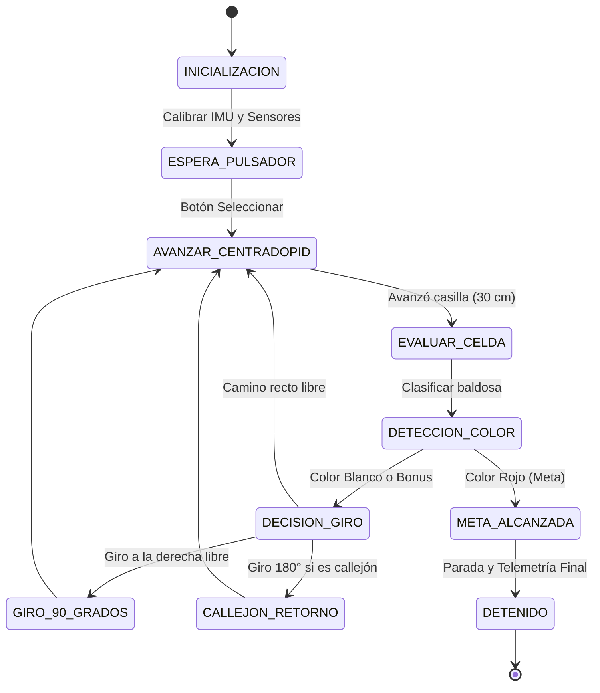
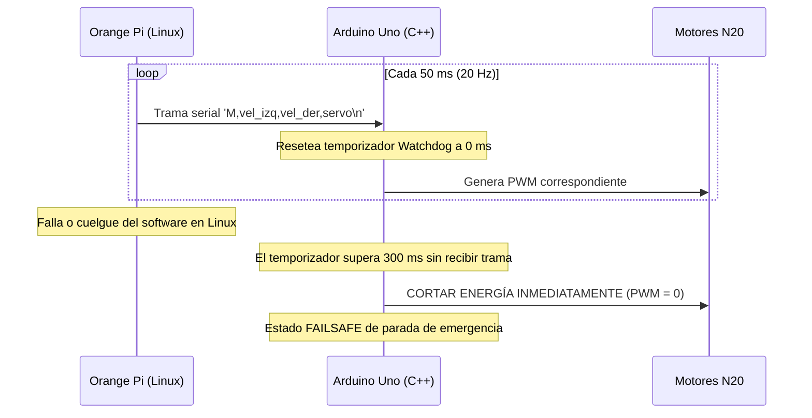

# 🧠 Lógica de Control, Matemáticas y Algoritmos

<div align="center">
  <p><strong>Fusión sensorial inercial, control lateral PID, máquinas de estados (FSM) y cinemática para 3nIgMa S3t3ki.</strong></p>
  <p>
    
    
    
    
  </p>
</div>

---

> [!NOTE]
> Cada modelo cinemático y ecuación diferencial de control fue verificado primero en el gemelo digital en Webots bajo condiciones de ruido estocástico antes de compilarse en la Capa de Abstracción de Hardware (HAL) de la Orange Pi.

---

## 🧭 1. Fusión Sensorial y Filtro Complementario (Eje Y)

El sensor inercial **MPU-6050** está orientado físicamente con su **eje Y coincidente con la dirección de avance longitudinal** del chasis.

```
                     ORIENTACIÓN DEL SENSOR MPU-6050 EN EL CHASIS
                                        [FRENTE]
                                           ▲
                                           │  +Y (Avance / Cabeceo Pitch)
                                           │
                           -X ◄────────────┼────────────► +X (Aceleración Lateral)
                                           │
                                           ⊙ +Z (Vertical Up / Guiñada Yaw)
                                        [TRASERA]
```

### A. Guiñada Horizontal (Yaw en Eje Z)
Para el seguimiento de rumbo en giros de 90° exactos dentro del laberinto:

1. **Calibración de Sesgo (*Bias*):**  
   Al encender el robot, durante los primeros 2.0 segundos de reposo se promedian 100 muestras de velocidad angular en $Z$ para obtener el error estático $b_z$.

2. **Filtro de Zona Muerta (*Deadband*):**  
   Para evitar que el ruido térmico acumule deriva durante tramos rectos, la velocidad angular se filtra según:

$$
\omega_{z,\text{filtrado}} = 
\begin{cases} 
0 & \text{si } |\omega_z - b_z| < 0.25^\circ/\text{s} \\ 
\omega_z - b_z & \text{en otro caso} 
\end{cases}
$$

3. **Integración Trapezoidal:**  
   A una frecuencia estricta de $f = 50\text{ Hz}$ ($\Delta t = 0.02\text{ s}$), el ángulo de rumbo acumulado se calcula mediante:

$$
\theta_{\text{yaw}}(k) = \theta_{\text{yaw}}(k-1) + \omega_{z,\text{filtrado}} \cdot \Delta t
$$

---

### B. Cabeceo Longitudinal (Pitch en Eje Y) y Detección de Rampas
Para detectar rampas ascendentes y descendentes en la Pista B sin necesidad de sensores mecánicos de contacto:

1. **Estimación por Acelerómetro:**  
   El ángulo de inclinación a partir de las componentes acelerométricas se obtiene con:

$$
\theta_{\text{acc}} = \text{atan2}\left(A_y, \sqrt{A_x^2 + A_z^2}\right) \cdot \left(\frac{180}{\pi}\right)
$$

2. **Filtro Complementario:**  
   Combina la respuesta instantánea del giróscopo en $X$ con la estabilidad a largo plazo del acelerómetro:

$$
\theta_{\text{pitch}}(k) = 0.96 \cdot (\theta_{\text{pitch}}(k-1) + \omega_x \cdot \Delta t) + 0.04 \cdot \theta_{\text{acc}}
$$

3. **Clasificador Dinámico de Terreno:**
   * $\theta_{\text{pitch}} > +6.0^\circ \implies$ **SUBIDA** (robot ascendiendo rampa).
   * $\theta_{\text{pitch}} < -6.0^\circ \implies$ **BAJADA** (robot descendiendo rampa).
   * $-6.0^\circ \le \theta_{\text{pitch}} \le +6.0^\circ \implies$ **PLANO** (superficie horizontal).

---

## 🎯 2. Control Lateral de Centrado PID en Pasillos de 30 cm

En la Pista A (Laberinto), el robot debe avanzar a través de celdas de $30\text{ cm} \times 30\text{ cm}$ sin raspar las paredes laterales.

```
       [PARED IZQ]                                                     [PARED DER]
       │                                                                         │
       │◄──────── dist_izq ────────►[ ROBOT ]◄──────── dist_der ────────►│
       │                                  │                                      │
       │                                  ▼                                      │
       │                             error = dist_izq - dist_der                 │
```

### Ecuación de Control Proporcional-Derivativo:

$$
e(t) = d_{\text{izq}}(t) - d_{\text{der}}(t)
$$

$$
u(t) = K_p \cdot e(t) + K_d \cdot \frac{e(t) - e(t - \Delta t)}{\Delta t}
$$

* **Comando a Motores:**

$$
\begin{aligned}
PWM_{\text{izq}} &= PWM_{\text{base}} - u(t) \\
PWM_{\text{der}} &= PWM_{\text{base}} + u(t)
\end{aligned}
$$

* **Parámetros Sintonizados:**
  - $PWM_{\text{base}} = 160$ (equivalente a $4.2\text{ rad/s}$ en ruedas a 7.8V).
  - $K_p = 1.45$: Corrección proporcional rápida ante desvíos.
  - $K_d = 0.35$: Amortiguamiento para evitar oscilaciones pendulares entre paredes.
  - **Manejo de Apertura de Pasillo:** Si $d_{\text{izq}} > 220\text{ mm}$ (intersección o pasillo abierto), el término correspondiente se anula y el robot se referencia únicamente contra la pared contigua existente a distancia fija ($110\text{ mm}$).

---

## 📏 3. Odometría sin Encoders: Dead-Reckoning a 7.8V

Debido a que el chasis opera sin encoders de rueda físicos, se implementó un modelo de odometría redundante basado en la curva lineal del motor N20 alimentado a tensión fija estabilizada:

1. **Relación Tensión-Velocidad:**

$$
\text{RPM}_{7.8\text{V}} = 260.0 \times \left(\frac{7.8\text{ V}}{6.0\text{ V}}\right) = 338.0\text{ RPM}
$$

$$
\omega_{\text{max}} = 338.0 \times \frac{2\pi}{60} = 35.39\text{ rad/s}
$$

2. **Velocidad Lineal de Crucero ($R = 0.02\text{ m}$):**  
   Comandando a $\omega_{\text{crucero}} = 4.2\text{ rad/s}$:

$$
v_{\text{lin}} = \omega_{\text{crucero}} \times R = 4.2 \times 0.02 = 0.084\text{ m/s} \quad (8.4\text{ cm/s})
$$

3. **Corrección Óptica por ToF Frontal:**  
   El avance por casilla de 30 cm se programa por temporización ($T_{\text{celda}} = 0.30 / 0.084 = 3.57\text{ s}$), pero cada vez que el sensor frontal VL53L1X detecta una pared transversal a menos de 40 cm, **reemplaza la estimación temporal por la distancia milimétrica absoluta**, reseteando cualquier error acumulado de patinaje de rueda.

---

## 🔄 4. Máquinas de Estados Finitas (FSM)

### FSM Pista A: Laberinto MAZE (5x5)
El robot implementa un explorador DFS (*Depth-First Search*) guiado por sensores de pared:



### FSM Pista B: Desniveles y Rampas
Supervisa activamente el ángulo de cabeceo (*Pitch*) para adaptar la tracción:
* **Estado NORMAL:** Tracción estándar en tramo plano.
* **Estado EN_RAMPA_SUBIDA ($\theta_{\text{pitch}} > +6^\circ$):** Incrementa PWM a 210 para superar la pendiente sin atascos.
* **Estado EN_RAMPA_BAJADA ($\theta_{\text{pitch}} < -6^\circ$):** Reduce PWM a 120 aplicando contramarcha leve para descenso controlado.
* **Estado APERTURA_COMPUERTA:** Al llegar a la zona de descarga, envía orden serial para que el servo SG90 abra la compuerta durante 2.5 segundos.

---

## 🛡️ 5. Mecanismo Watchdog de Seguridad (Hardware Failsafe a 300 ms)

Para evitar que el robot colisione si el proceso Python en Linux se congela o sufre sobrecarga de memoria:


