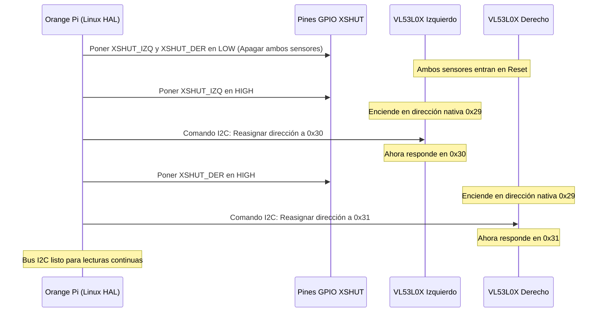

# ⚡ Arquitectura Eléctrica y Esquemas de Conexión

<div align="center">
  <p><strong>Topología de alimentación desacoplada, gestión de buses digitales, adaptación de niveles lógicos y topología de tierras en 3nIgMa S3t3ki.</strong></p>
  <p>
    
    
    
    
  </p>
</div>

---

> [!IMPORTANT]
> Para consultar la asignación detallada de los 26 pines del conector GPIO de la Orange Pi Zero 2W, revisa directamente el documento complementario: **[PINOUT.md](PINOUT.md)**.

> [!CAUTION]
> Asegúrate de que las tierras lógicas de la Orange Pi, del Arduino Uno y de ambos convertidores LM2596 confluyan en un **nodo de tierra común en estrella**. Una tierra flotante causará pérdida de sincronismo en la trama serial UART y lecturas erróneas en el bus I2C.

---

## 🔌 1. Diagrama Jerárquico de Alimentación y Conexiones

```
                     ┌────────────────────────────────────────┐
                     │          BATERÍA LiPo 3S (11.1V)       │
                     └───────────────────┬────────────────────┘
                                         │
                         ┌───────────────┴───────────────┐
                         ▼                               ▼
               [LÍNEA DE POTENCIA]               [LÍNEA LÓGICA]
               Buck LM2596 #1 (7.8V)            Buck LM2596 #2 (5.0V)
                         │                               │
                         │               ┌───────────────┴───────────────┐
                         │               ▼                               ▼
                         │        Arduino Uno R3 ◄───UART (TX->RX)─── Orange Pi Zero 2W
                         │       (Control Tracción)   (115200 Baud)   (Linux ARM64 / Visión)
                         │               │                               │
                         ▼               ▼                               │
                   Driver DRV8833 ◄──────┘ (D3, D5, D6, D11 PWM)         │
                   (Puente H MOSFET)                                     │
                         │                                               │
                         ▼                                               ▼
                  Motores N20 (100:1)                           Periféricos y Buses:
                   (Tracción 7.8V)                               - Bus I2C (/dev/i2c-2):
                                                                   * IMU MPU-6050 (0x68)
                                                                   * OLED SSD1306 (0x3C)
                                                                   * ToF Frontal VL53L1X (0x29)
                                                                   * ToF Lat. Izq VL53L0X (0x30)*
                                                                   * ToF Lat. Der VL53L0X (0x31)*
                                                                 - Bus SPI (/dev/spidev1.0):
                                                                   * PixyCam v2 (Color de suelo)
                                                                 - Puerto USB (/dev/video1):
                                                                   * Webcam USB (Marcadores ArUco)
```

---

## 🔒 2. Aislamiento Galvánico y Desacoplamiento de Ruido

Los micromotores N20 bajo carga brusca o cambios de marcha producen dos perturbaciones graves si comparten alimentación con la lógica:
1. **Caídas de Tensión (*Voltage Sags*):** Al acelerar, la demanda de corriente transitoria puede provocar caídas por debajo de los 4.65V necesarios para la Orange Pi, provocando reinicios (*brownouts*).
2. **Picos Inductivos de Retorno:** La energía inductiva almacenada en el bobinado de los motores genera picos de alta frecuencia.

### Solución Implementada:
* **Doble Regulador Buck LM2596:** Dos módulos independientes alimentados desde la misma batería LiPo 3S. El convertidor #1 abastece exclusivamente los 7.8V de potencia para el DRV8833, mientras el convertidor #2 genera 5.0V limpios con filtrado capacitivo para la SBC y el Arduino.
* **Tierra en Estrella (*Star Grounding*):** El retorno de corriente de potencia de los motores regresa directamente al borne negativo del módulo LM2596 #1 sin atravesar las pistas lógicas de la Orange Pi.

---

## ⚡ 3. Compatibilidad de Niveles Lógicos UART (3.3V -> 5.0V)

La comunicación entre la Orange Pi Zero 2W y el Arduino Uno es **estrictamente unidireccional (Simplex)**: la Orange Pi envía paquetes de consigna de velocidad y el Arduino únicamente ejecuta sin emitir respuesta.

### Justificación de Conexión Directa sin Convertidor de Nivel:
El microcontrolador ATmega328P del Arduino Uno trabaja a $V_{CC} = 5.0\text{ V}$. De acuerdo con su hoja de datos oficial:
$$\text{Umbral Mínimo de Entrada ALTA } (V_{IH}) = 0.6 \times V_{CC} = 0.6 \times 5.0\text{ V} = 3.0\text{ V}$$

Dado que el pin `TX` de la Orange Pi Zero 2W emite una señal de $V_{OH} = 3.3\text{ V}$, se cumple con holgura:
$$3.3\text{ V} > 3.0\text{ V}$$

Por lo tanto:
* La señal de 3.3V es interpretada como un nivel `HIGH` lógico estable y libre de fluctuaciones.
* El pin `RX` de la Orange Pi (`PH3`) permanece **desconectado**, eliminando cualquier riesgo de que los 5.0V del Arduino alcancen el silicio de la SBC.

---

## 🎛️ 4. Secuencia de Arranque del Bus I2C y Pines XSHUT

Los sensores de distancia VL53L0X comparten de fábrica la misma dirección I2C (`0x29`). Para operar dos sensores laterales simultáneamente en el mismo bus `/dev/i2c-2`, el sistema utiliza una secuencia de arranque secuencial controlada por software mediante los pines **XSHUT**:



### Pines GPIO Asignados para XSHUT:
* **XSHUT Frontal (VL53L1X):** Pin 16 (`PH4`)
* **XSHUT Lateral Izquierdo:** Pin 29 (`PI0`)
* **XSHUT Lateral Derecho:** Pin 31 (`PI15`)

---

## 🔴 5. Pulsadores de Interfaz y Parada de Emergencia

Los pulsadores físicos montados en el chasis se conectan directamente a pines GPIO con resistencia interna de pull-up activada por software:
* **Pulsador Navegar:** Pin 35 (`PI2`) -> Pulsación conecta a GND.
* **Pulsador Seleccionar:** Pin 37 (`PI16`) -> Pulsación conecta a GND.

Durante la carrera autónoma, la rutina de interrupción por cambio de estado (*edge detection*) detecta cualquier pulsación en menos de 20 ms, transmitiendo inmediatamente el paquete `M,0,0,0\n` al Arduino para detener el robot en seco y regresar al menú OLED.
